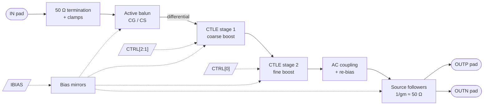

# Programmable 8 Gb/s CTLE in SkyWater SKY130

## Description
A two-stage, digitally programmable continuous-time linear equalizer (CTLE) for chip-to-chip serial links up to **8 Gb/s(Pcie 3.0)** (4 GHz Nyquist), designed for the open-source **SkyWater SKY130** process design kit (PDK) and proposed for **Chipalooza Challenge #4**.

A 3-bit  control selects 8 equalization levels covering **10–20 dB** of channel loss at Nyquist. The block takes a single-ended input, converts it on-chip to differential, equalizes it in two stages and drives a 50 Ω-matched differential output off-chip.

---

## Key Specifications (targets)

| Parameter | Target | Units | Condition / Notes |
| :--- | :--- | :--- | :--- |
| **Technology** | SkyWater SKY130 | — | 130 nm CMOS open-source PDK |
| **Supply Voltage (VPWR)** | 1.62 – 1.98 | V | 1.8 V nominal, slot supply |
| **Data Rate** | 8 | Gb/s | NRZ, UI = 125 ps |
| **Peaking Frequency** | 3.5 – 4.5 | GHz | All codes |
| **Boost Range** | 10 – 20 | dB | Peak − DC gain, code 000 → 111 |
| **Boost Control** | 3 bits (8 codes) | — | ~1.43 dB per step|
| **Input Return Loss (S11)** | ≥ 10 | dB | 0–2 GHz, pad and package included |
| **Output Return Loss (S22)** | ≥ 10 | dB | 0–4 GHz, each output |
| **Eye Height, CTLE Core Output** | 225 – 275 | mVpp,diff | Matched code and channel; simulation |
| **Eye Width** | ≥ 0.35 | UI | PRBS7 |
| **Supply Current** | ~16 (≤ 20) | mA||
| **Temperature Range** | −40 to 110 | °C | Post-layout PVT |
---

## Architecture Overview

Solid lines carry the signal; dashed lines are static control and bias.

1. **Input Network:**
   * Single-ended input on a dedicated pad.
   * On-chip 50 Ω termination and core-side clamps for the overvoltage protection 1.8 V devices need behind a pad.

2. **Active Balun:**
   * A common-gate/common-source pair converts the input to a balanced differential signal.
   * The common-gate device sets the 50 Ω input match.

3. **Two-Stage Degenerated CTLE Core:**
   * Two cascaded source-degenerated differential stages with resistor loads.
   * Fixed MIM degeneration capacitors bridge the source nodes directly, with no switch in series.
   * Binary-weighted degeneration-resistor banks set the boost. The switches sit at the differential virtual ground (the midpoint of a split resistor) to keep their resistance and capacitance out of the signal path.
   * A switched tail-current bank levels the peak gain across codes.

4. **Output Drivers:**
   * The CTLE output is AC-coupled through a MIM capacitor and re-biased for headroom.
   * One NMOS source follower per side; its 1/gm back-terminates the line without a resistor.

5. **Control & Bias:**
   * `CTRL[2:0]` drives the resistor and tail banks directly: stage 1 takes the two coarse bits, stage 2 the fine bit.
   * Bias currents are mirrored from the harness reference current.

---

## Pinout (proposal)

| Pin | Type | Direction | Harness Resource | Function |
| :--- | :--- | :--- | :--- | :--- |
| `IN` | Analog, high speed | In | Dedicated pad 0 | Single-ended data input, AC-coupled off-chip |
| `OUTP` | Analog, high speed | Out | Dedicated pad 1 | Equalized output, positive, into 50 Ω |
| `OUTN` | Analog, high speed | Out | Dedicated pad 2 | Equalized output, negative, into 50 Ω |
| `CTRL[2:0]` | Digital, static | In | Control inputs 0–2 | Boost code |
| `IBIAS` | Analog, DC | In | Harness reference current 0 | Bias reference, mirrored on-chip |
| `VPWR`, `VGND` | Power | — | Slot supply | 1.8 V core supply and ground |

All three dedicated pads are used pad-direct; no shared analog lines are needed.

---

## Toolchain & PDK Setup

* **Schematic Capture:** Xschem
* **Simulation Engine:** ngspice
* **Layout & DRC:** Magic VLSI and KLayout
* **LVS:** Netgen and KLayout
* **Parasitic Extraction:** Magic VLSI
* **Characterization:** CACE
* **Environment:** Open Source Tools
* **Process Design Kit:** SkyWater SKY130 open PDK

---

## Proposal

The Challenge #4 proposal is in [`docs/proposal/ctle_proposal.pdf`](docs/proposal/ctle_proposal.pdf) (LaTeX source alongside).

---

## License

Apache-2.0 WITH SHL-2.1 (Solderpad Hardware License v2.1), inherited from the [Chipalooza analog project template](https://github.com/simi1505/sg13cmos5l_chipalooza_analog_project). See [`LICENSE`](LICENSE).
